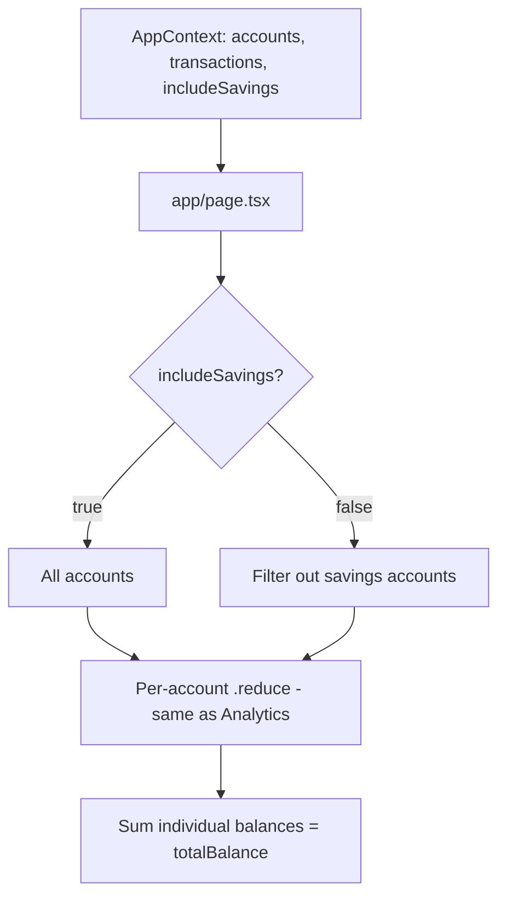

## Product Overview

Fix a bug on the Homepage where the Total Balance calculation ignores Transfer transactions, causing inaccurate balance display when money is moved between accounts (especially to/from excluded savings accounts).

## Core Features

- Refactor the Homepage Total Balance to be the sum of individual account balances (matching the Analytics page's per-account calculation logic)
- Each account balance is computed as: Income + Transfers In - Expenses - Transfers Out
- Filter out accounts containing "saving"/"savings" when the `includeSavings` toggle is off
- Sum the remaining filtered account balances to produce the final Total Balance
- Ensure the `accounts` array is destructured from context and included in the `useMemo` dependency array

## Tech Stack

- Framework: Next.js (App Router, Client Components)
- Language: TypeScript + React
- State: React Context (`lib/context.tsx`) with `useMemo` for derived calculations
- Data: Supabase (transactions table with `type`, `account`, `to_account`, `amount` fields)

## Implementation Approach

**Strategy**: Replace the flat transaction-level reduce in `app/page.tsx` with an account-centric calculation that mirrors the proven Analytics page logic, then apply `includeSavings` filtering at the account level (not the transaction level).

**How it works**:

1. Destructure `accounts` from the app context (currently missing)
2. Filter the `accounts` array to exclude savings accounts when `includeSavings` is false
3. For each remaining account, compute its balance using the same double-entry reduce logic from `app/analytics/page.tsx` (Income + Transfers In - Expenses - Transfers Out)
4. Sum all individual balances to get the final `totalBalance`

**Key technical decisions**:

- Reuse the exact same `.reduce()` pattern from Analytics (lines 39-49 of `app/analytics/page.tsx`) to guarantee consistency between pages
- Filter at the **account level** rather than the transaction level, which is both simpler and semantically correct (a transfer out of HSBC into Savings should reduce HSBC's balance regardless of savings filter state)
- Add `accounts` to the `useMemo` dependency array to ensure recalculation when accounts change

**Performance**: The new logic iterates `accounts.length * transactions.length` which is O(A*T). For a personal expense tracker with typically <10 accounts and <10K transactions, this is negligible. The Analytics page already runs this exact computation without issue.

## Implementation Notes

- **Grounded pattern reuse**: The per-account balance reduce logic is copied verbatim from `app/analytics/page.tsx` lines 39-49. No new patterns introduced.
- **Backward compatibility**: The `todayTransactions`, `weeklyTransactions`, and `dynamicTrendData` calculations are NOT modified -- they remain expense-only aggregations unrelated to this bug.
- **Account name matching**: Uses `.toLowerCase().trim()` for case/whitespace-insensitive comparison, matching the existing Analytics convention.
- **Savings filter**: Uses `.toLowerCase().includes('saving')` on account names (covers both "saving" and "savings"), consistent with the existing pattern in the old code and `app/profile/page.tsx` line 33.

## Architecture Design

The change is confined to a single `useMemo` block in `app/page.tsx`. No new modules, components, or data flows are introduced.



**Data flow for a single account balance**:

- For each transaction where `tx.account` matches: Income adds, Expense subtracts, Transfer subtracts (money leaving)
- For each transaction where `tx.to_account` matches and type is Transfer: adds (money arriving)

## Directory Structure

```
app/
  page.tsx    # [MODIFY] Refactor totalBalance useMemo: destructure `accounts` from context, filter by includeSavings at account level, compute per-account balance using Analytics-style reduce, sum for final total. Lines 29 and 37-46 are the modification targets.
```

## Key Code Structures

The new `totalBalance` computation (replacing lines 37-46 of `app/page.tsx`):

```typescript
const totalBalance = useMemo(() => {
  const activeAccounts = includeSavings
    ? accounts
    : accounts.filter(acc => !acc.toLowerCase().includes('saving'));

  return activeAccounts.reduce((total, accountName) => {
    const balance = transactions.reduce((acc, tx) => {
      let newAcc = acc;
      if (tx.account?.toLowerCase().trim() === accountName.toLowerCase().trim()) {
        if (tx.type === "Income") newAcc += Number(tx.amount);
        if (tx.type === "Expense" || tx.type === "Transfer") newAcc -= Number(tx.amount);
      }
      if (tx.type === "Transfer" && tx.to_account?.toLowerCase().trim() === accountName.toLowerCase().trim()) {
        newAcc += Number(tx.amount);
      }
      return newAcc;
    }, 0);
    return total + balance;
  }, 0);
}, [transactions, includeSavings, accounts]);
```

## Agent Extensions

### SubAgent

- **code-explorer**
- Purpose: Verify the exact current state of `app/page.tsx` before making modifications, ensuring line numbers and destructuring match expectations
- Expected outcome: Confirmed file contents so the edit is precise and avoids regressions